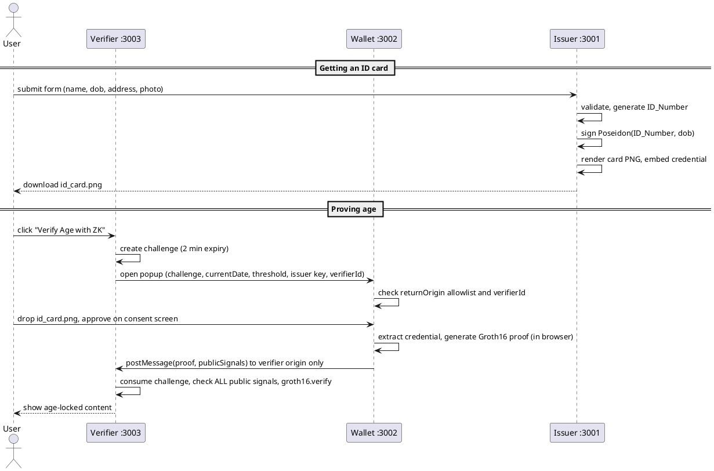
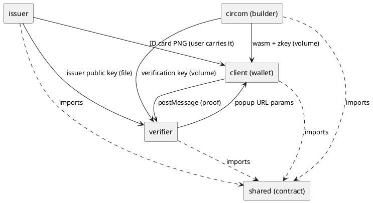

# ZK Age Verification Demo

A user gets a digital ID card (a PNG image) from a mock "government". A signed credential
is hidden inside the image. Later, a website asks "are you 18+?". The user drops their ID
image into a wallet popup. The wallet creates a **zero-knowledge proof** that says *"a
trusted government signed my birthdate, and it makes me at least 18"*. The proof does not
reveal the birthdate, the ID number or the signature. The website checks the proof and
lets the user in.

> **Demo for a student project, not a production system.** It has no HTTPS, a locally
> generated (insecure) trusted setup and a public demo issuer key. Never use it with real
> identity data. See [Known limitations](#known-limitations).

| Part | Technology |
|---|---|
| Servers | Node.js 22 + Express 5 |
| UIs | Vanilla JS + HTML (no framework, no bundler) |
| Circuit | Circom 2.1.9 + circomlib 2.0.5 (about 4,600 constraints) |
| Proofs | snarkjs 0.7.6, Groth16, made **in the browser** |
| Signatures / hashing | EdDSA on BabyJubJub, Poseidon (circomlibjs 0.1.7) |
| Card rendering | Puppeteer (headless Chromium) |
| Packaging | Docker Compose |

---

## Quick start

You need Docker with Compose v2.

```bash
cd zk-age-verification
docker compose up --build
```

The first start takes a few minutes. It compiles the Circom compiler, generates the Powers
of Tau and installs Chromium. Later starts are fast, because the circuit build is skipped
when nothing changed. When the issuer, client and verifier logs say "listening":

1. Open **http://localhost:3001** (Issuer). Fill in the form with a made-up birthday at
   least 18 years ago, and download `id_card.png`.
2. Open **http://localhost:3003** (Verifier) and click **Verify Age with ZK**. Allow the popup.
3. In the wallet popup (port 3002), drop in `id_card.png` and click **Approve**.
   The proof takes about 2 seconds, and then the verifier shows the age-locked page.

Try a card with a birthday less than 18 years ago: the wallet refuses before proving.
Try a screenshot of the card: the wallet finds no credential.

Use `localhost`, not `127.0.0.1`. The origins are part of the security checks.
`docker compose down -v` removes the containers and the volumes (artifacts and key).

---

## How it works

```
 Issuer :3001                    Wallet :3002 (popup)                 Verifier :3003
 ------------                    --------------------                 --------------
 form -> validate              <- opened with public params ------  POST /challenge
 ID_Number = 128 random bits      (challenge, currentDate,           (31 random bytes,
 sign Poseidon(ID_Number, dob)     threshold, issuer key,             2-minute, single use)
 render card (Puppeteer)           verifierId, returnOrigin)
 embed credential in PNG          check allowlist + verifierId
        |                         user drops PNG, approves
        | id_card.png             groth16.fullProve() in browser
        +----- user carries ----> postMessage(proof, returnOrigin) -->  POST /verify:
                                                                      consume challenge,
                                                                      check ALL 6 public
                                                                      signals, groth16.verify
                                                                      -> session.verified
```

PlantUML source of the sequence (paste into any PlantUML renderer):



### The circuit in one table

| | Signals |
|---|---|
| Private inputs | `dob`, `ID_Number`, `signatureR8x`, `signatureR8y`, `signatureS` |
| Public inputs, **in this order** | `challenge`, `currentDate`, `issuerPubKeyX`, `issuerPubKeyY`, `ageThreshold`, `verifierId` |
| Public outputs | **none**, so nothing unique to the user is ever revealed (unlinkability) |

Constraints: `msg = Poseidon(ID_Number, dob)`. `EdDSAPoseidonVerifier` with `enabled = 1`
checks the signature. `Num2Bits(32)` range-checks `dob`, `currentDate` and
`ageThreshold`. Then `dob <= currentDate` (`LessEqThan(32)`) and
`currentDate - dob >= ageThreshold` (`GreaterEqThan(32)`). Two "keep-alive" squares use
`challenge` and `verifierId`. Details: [`circom/README.md`](circom/README.md).

### Age arithmetic (it confuses people)

Dates are `YYYYMMDD` integers (15 March 2008 = `20080315`). The rule is
`currentDate - dob >= 180000`. Subtracting two `YYYYMMDD` numbers gives
`years*10000 + months*100 + days` (the month and day parts can be negative). So `180000`
means "18 years, 0 months, 0 days": the person has had their 18th birthday. It is **not**
a number of days. With today = `20261025`:

- born `20081025`: `180000`, **passes** (turns 18 today)
- born `20081026`: `179999`, **fails** (turns 18 tomorrow)

This is exact for real calendar dates, because the month and day parts can never add up
to more than ±1130. A person born on 29 February counts as 18 on 1 March in non-leap
years.

---

## Repository layout

```
zk-age-verification/
├── docker-compose.yml   .env.example   .dockerignore   README.md
├── shared/              THE CONTRACT: constants.js (UMD), credential.schema.json, generated/
├── circom/              Module 3: circuit, build.sh, circuit tests        (owner C)
├── issuer/              Module 1: mock government, port 3001              (owner A)
├── client/              Module 2: ZK wallet popup, port 3002              (owner B)
├── verifier/            Module 4: age-locked site, port 3003              (owner D)
├── artifacts/           (gitignored) wasm, zkey, verification key from the circuit build
└── tests/integration/   end-to-end tests that cross modules
```

Each module has its own `package.json`, `Dockerfile`, `test/` and `README.md`. The README
says what the module does, how to run it alone, its environment variables and what it
expects from the others.

**Isolation rules.** Modules never `require` each other. The only shared code is
`shared/` (we check this with grep: every cross-folder import points to `shared/`).
Modules exchange data only through these interfaces:

| Producer | Consumer | How |
|---|---|---|
| Issuer | User, then Wallet | ID card PNG (format: `shared/credential.schema.json`) |
| Issuer (`keygen`) | Verifier | `shared/generated/issuer-pubkey.json` (`issuer-pubkey` volume) |
| Circom builder | Wallet | `age_check.wasm`, `age_check_final.zkey` (`artifacts` volume, read-only) |
| Circom builder | Verifier | `verification_key.json` (`artifacts` volume, read-only) |
| Verifier | Wallet | popup URL query parameters (public values only) |
| Wallet | Verifier | `postMessage({ proof, publicSignals }, verifierOrigin)` |



**Docker Compose services:** `circom-builder` (one-shot, writes the `artifacts` volume)
and `keygen` (one-shot, reuses the issuer image, writes the `issuer-pubkey` volume).
Then `issuer`, `client` and `verifier` start, each with `depends_on: …
service_completed_successfully`. Every image builds from the repo root
(`dockerfile: <module>/Dockerfile`) so it can copy `shared/`. Containers run as the
non-root `node` user, and ports are published on `127.0.0.1` only.

---

## Running and testing without Docker

Needs Node 22.12+, Circom 2.1.x on your `PATH` (only for building the circuit), and
Chromium (Puppeteer downloads one on `npm install`, or set `CHROMIUM_PATH`).

```bash
cd zk-age-verification
for m in circom issuer client verifier tests/integration; do (cd $m && npm install); done

(cd circom && npm run build)                           # -> ../artifacts (about 5 min the first time)
export ISSUER_PRIVATE_KEY=34e7d650cb34d80c2ff40f5d5cfee821eeac0597412afc232791f4b54ebae82a  # DEMO ONLY
(cd issuer && npm run keygen)                          # -> shared/generated/issuer-pubkey.json

# three terminals:
(cd issuer && npm start)      # http://localhost:3001
(cd client && npm start)      # http://localhost:3002
(cd verifier && npm start)    # http://localhost:3003
```

**Tests.** `npm test` works inside every module on its own, with no other module running:

| Where | Tests | What | Time |
|---|---|---|---|
| `circom/` | 25 | real circuit: valid adult, boundary, underage, future, tampered/forged signature, wrong issuer, wraparound range checks, policy compare, public-signal order vs constants | ~10 s |
| `issuer/` | 50 | validation, schema, signature, PNG round trip, **HTML injection shown as plain text**, renderer isolation, HTTP | ~15 s |
| `client/` | 49 | allowlist (wrong `returnOrigin` refused), request parsing, `verifierId`, PNG parser, CSP / MIME headers | ~1 s |
| `verifier/` | 50 | ordered checks, replay, expiry, every wrong signal, races, protected page, rate limit | ~2 s |
| `tests/integration/` | 17 | **real issuer card → real verifier accepts**, replay, expiry, cross-site, underage, full browser flow | ~30 s |

```bash
for m in circom issuer client verifier tests/integration; do (cd $m && npm test); done
```

If you run as root on Linux (e.g. CI), set `CHROMIUM_NO_SANDBOX=1` for the issuer and
integration tests. To run the integration tests against the Docker stack instead of
local servers: `cd tests/integration && USE_RUNNING_STACK=1 npm test`. Module tests also
run inside the images, e.g. `docker compose run --rm issuer npm test`.

Several tests were **mutation-checked**: we broke the protection on purpose and checked
the test turns red. This covers the circuit range check and `enabled` flag, HTML escaping,
request blocking and JS-off in the renderer, the used-challenge list, the protected
success page, and the verifier page's `event.origin` check.

---

## Configuration

All configurable values are in [`.env.example`](.env.example). Copy it to `.env` to
change them; Compose reads `.env` automatically.

| Variable | Used by | Default |
|---|---|---|
| `ISSUER_PRIVATE_KEY` | issuer, keygen | demo key, **DEMO ONLY, never reuse** (it is public) |
| `SESSION_SECRET` | verifier | empty = random secret at each start |
| `ALLOWED_VERIFIER_ORIGINS` | wallet | `http://localhost:3003` |

Ports, origins, the threshold and the public-signal order are fixed in
[`shared/constants.js`](shared/constants.js), so they cannot drift between modules.

---

## Threat model

**What the system protects:** the verifier learns only "the holder has a credential from
this issuer and is at least 18". It never sees the DOB, the ID number, the name or the
signature. The circuit has no public outputs, and Groth16 proofs are randomized, so two
proofs from the same card cannot be linked to each other or to the issuer's records.

| Attack | Defense | Tested in |
|---|---|---|
| Replaying an old proof | Single-use, 2-minute server challenge, checked against the public signals. Also an in-memory "used" list so two parallel requests cannot both spend it | `verifier/test/server.test.js`, `tests/integration/e2e.test.js` |
| Using a proof on a different website | `verifierId` public input checked by the verifier. The wallet also checks that `verifierId` belongs to `returnOrigin` | `verifier`, `client`, `e2e`, `browser` tests |
| Forging a credential | EdDSA signature verified inside the circuit (`enabled = 1`) | `circom/test/age_check.test.js` |
| Using the wrong issuer | Verifier checks the issuer public key; wallet warns early | `circom`, `verifier`, `client` tests |
| Lowering the age threshold | Verifier checks `ageThreshold == "180000"` (exact decimal string) | `circom`, `verifier`, `e2e` tests |
| "Negative age" wraparound trick | `Num2Bits(32)` range checks + `dob <= currentDate` in the circuit | `circom` tests (mutation-checked) |
| Malicious site stealing the proof | `postMessage` with an exact target origin (never `*`), exact-match wallet allowlist, verifier page accepts only the wallet origin and its own popup | `client`, `browser` tests |
| Malicious input in the ID form | HTML escaping, JS disabled, all requests except `data:` blocked, strict CSP in the card page; uploads validated, size- and pixel-limited and re-encoded | `issuer/test/render-card.test.js`, `validate.test.js` |
| Session fixation / stealing the cookie | Session id regenerated on success; `httpOnly`, `SameSite=Lax` cookie | `verifier` tests |
| A site probing your exact birthday with odd questions | Wallet only accepts whole-year thresholds and a `currentDate` within ±1 day of the local clock | `client` tests |
| Script injection in the wallet stealing the card | Wallet CSP: scripts only from its own origin, `connect-src 'self'`, no workers, no framing | `client`, `browser` tests |

What the design **does not** defend against is listed next.

---

## Known limitations

- **The ID card is a bearer token.** Anyone who gets a copy of the PNG can make proofs
  with it, for example a minor borrowing an adult's card. `ID_Number` does **not**
  prevent this. *Stretch goal:* add a secret that only the wallet knows to the signed
  hash, so the card alone is useless.
- **No issuer authentication or identity checks.** The mock issuer signs whatever
  birthday you type in, so anyone can get an "adult" card. This is out of scope for the
  demo.
- **The PNG metadata is not encrypted.** Anyone with the file can read the name, address,
  birthday, ID number and signature.
- **It is metadata embedding, not true steganography.** Screenshots, messaging apps and
  image editors strip the data. Only the original downloaded file works.
- **Only `ID_Number` and `dob` are signed.** The name, address, contact and photo on the
  card are unsigned display data and can be edited without anyone noticing. The circuit
  ignores them.
- **No revocation.** A stolen or wrong credential cannot be cancelled, and credentials
  never expire.
- **No per-user nullifier.** One person can make unlimited proofs, so there is no
  "one person, one account" guarantee.
- **No HTTPS.** This is a localhost demo only. Cookies are not `Secure`, and nothing is
  encrypted in transit.
- **Cookies are not isolated by port.** Browsers keep separate `localStorage` per port,
  but cookies for `localhost` are sent to all three ports, and the three services count
  as "same-site" to each other. The verifier's session cookie is therefore also sent to
  the issuer and the wallet servers (which ignore it). In a real deployment each party
  has its own domain.
- **The trusted setup is generated locally and is not secure.** Whoever ran the build
  could forge proofs. Fine for a demo only. A real system needs a multi-party ceremony or
  a proof system without a per-circuit trusted setup.
- **The wallet's `localStorage` is unencrypted** ("Remember my card").
- **The verifier's clock decides `currentDate`.** The wallet only does a rough ±1 day
  check against the user's own clock, which could also be wrong. All dates are UTC.
- **A web wallet trusts its server.** Whoever controls port 3002 could serve a malicious
  wallet page that leaks the card. A real wallet would be an installed app or extension.
- **State is in memory.** Sessions, rate-limit counters and the used-challenge list
  reset when the verifier restarts, and they would not be shared between several
  instances.
- **Issuer key distribution is a shared file.** There is no PKI, no key rotation and no
  HSM. The demo private key is public.
- **Tested in Chromium only** (headless, via Puppeteer and Playwright).

---

## Decisions beyond the spec (please review)

The spec asked us to flag anything we changed or added rather than change it silently.
Each item is small, and the module READMEs explain it in more detail.

1. **`verifierId` = first 31 bytes of SHA-256(origin)**, instead of the suggested
   "for example a Poseidon hash". This lets the **wallet** recompute it from
   `returnOrigin` with the browser's WebCrypto (no bundler needed) and refuse requests
   whose `verifierId` belongs to another site. That closes a relay attack between two
   allowlisted sites. ([client](client/README.md#additions-beyond-the-spec-please-review))
2. **The verifier compares `currentDate` with the date it issued with the challenge**
   (at most 2 minutes old), not the date at verify time. This avoids a spurious failure
   at midnight, and it can only make the check stricter.
   ([verifier](verifier/README.md#small-deviations-from-the-spec-please-review))
3. **The success page lives in `verifier/protected/`, not `public/`.** `express.static`
   would serve anything in `public/` to everyone.
4. **An in-memory used-challenge list** in addition to deleting the challenge from the
   session. A test showed that two parallel `/verify` requests sharing a session could
   otherwise both pass.
5. **snarkjs proves single-threaded.** Its worker threads are `blob:` URLs, which the
   spec's CSP (`script-src 'self' 'wasm-unsafe-eval'`) blocks; proving then hangs. We
   kept the strict CSP (plus `worker-src 'none'`) and accept about 2 s per proof. The
   wallet also times out after 60 s with a clear error.
6. **Wallet privacy checks:** only whole-year thresholds and a `currentDate` near the
   local date are accepted.
7. **CORS on `.wasm` / `.zkey`:** they are same-origin downloads for the wallet, so the
   "correct" CORS is **none**. Only the correct MIME types are set.
8. **Contact info** is collected and validated and stored in the credential as an
   optional, unsigned `contact` field (the spec's JSON example has no such field). It is
   not printed on the card.
9. **`SESSION_SECRET`** may be empty: the verifier then uses a random secret per start
   instead of a fixed shared default.
10. **`CHALLENGE_TTL_MS`** (default 2 minutes) can be overridden. Only the integration
    test does this, to test expiry quickly.
11. The circuit has **about 4,600 constraints**, not about 6,000, so `2^14` Powers of Tau
    is plenty.
12. The card shows the **last 4 digits** of `ID_Number` (it looks like a real card).
    The full number stays in the hidden credential.
13. Chromium's sandbox is turned off (`--no-sandbox`) **only** when
    `CHROMIUM_NO_SANDBOX=1`, which the issuer Docker image sets. Locally the sandbox
    stays on.

## Licensing note

`circomlib` is GPL-3.0, and the circuit includes its templates. Check the license
implications before reusing this code elsewhere.
